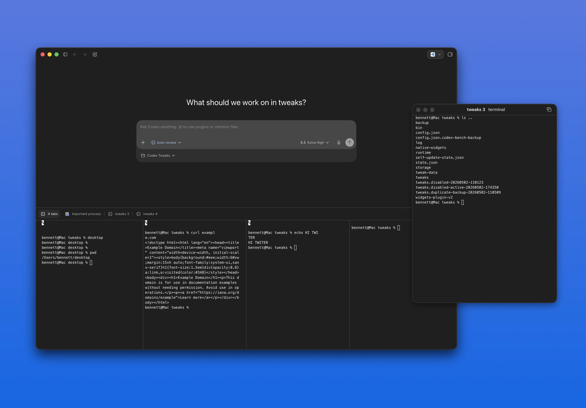

# Better Terminal



Better Terminal is a [Codex++](https://github.com/b-nnett/codex-plusplus) tweak that makes Codex terminal workspaces feel closer to a native terminal app while keeping Codex's own terminal sessions live.

## Features

- Split terminal panes from the tab context menu, `Cmd+D`, or by dragging a terminal tab into the terminal area.
- Keep up to six live panes grouped in one tab, with resizeable dividers and pane-aware `Cmd+W`.
- Pop a terminal into a Codex mini-window with matching terminal chrome, always-on-top support, and return-to-tab controls.
- Rename terminal tabs with a Codex-style dialog and persistent local titles.
- Switch focused terminal tabs with `Cmd+1` through `Cmd+9`, and rename with `Cmd+Option+R`.
- Clear the focused terminal with `Cmd+K`.
- Toggle autoscroll per terminal pane or set the default from Better Terminal settings.
- Show running and finished-process states in terminal tabs.
- Pause runaway terminal process trees when they exceed the configured memory threshold, with a system alert from the affected window.

## Install

Clone or copy this folder into your Codex++ tweaks directory:

```sh
~/Library/Application Support/codex-plusplus/tweaks/co.bennett.better-terminal
```

Then restart Codex or reload Codex++ tweaks.

## Release

Version `1.0.0` is the first release-ready build of Better Terminal. It includes split panes, terminal popouts, keyboard shortcuts, tab renaming, autoscroll controls, and memory watchdog protection.

## Development

```sh
npm test
node --check index.js
```
